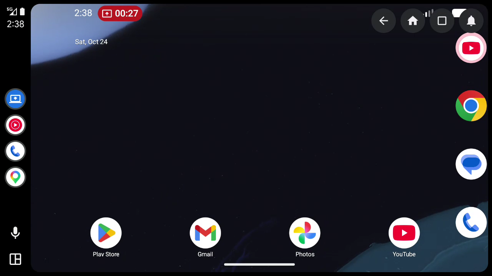
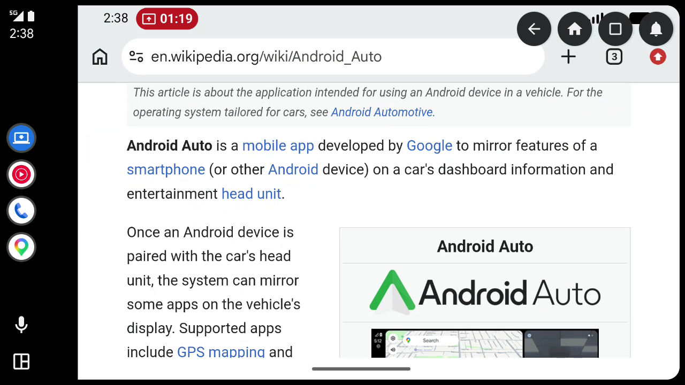
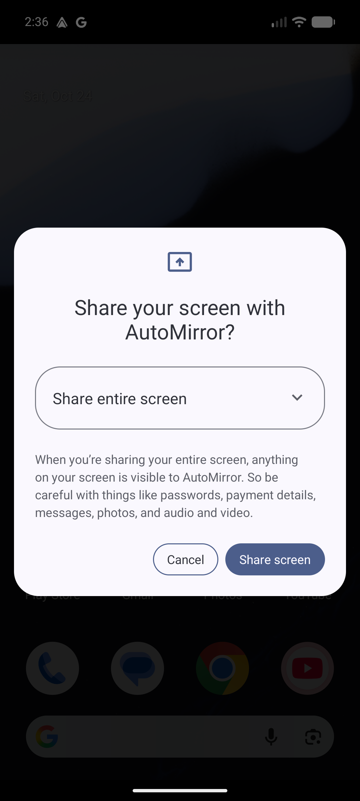
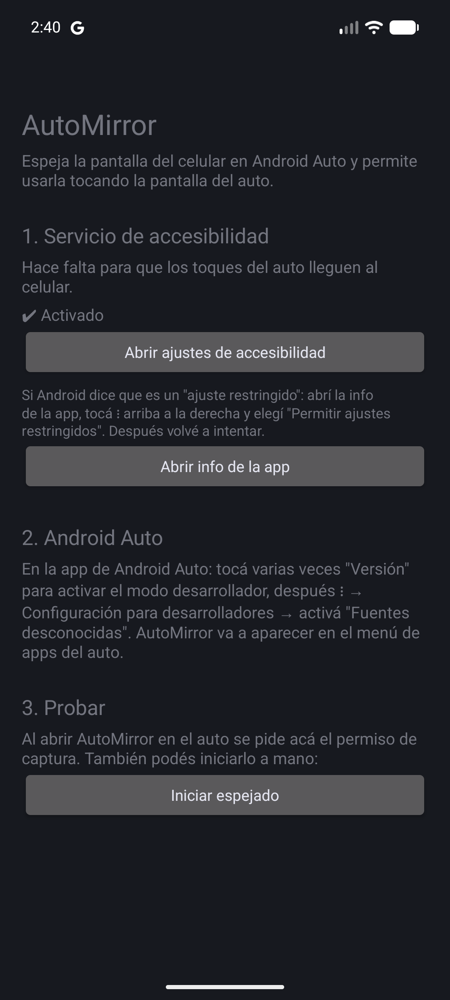

# AutoMirror

Espeja la pantalla del celular en **Android Auto** y permite usarlo tocando la pantalla del auto.

Al conectar el celular al auto, AutoMirror aparece en el menú de apps de Android Auto. Al abrirla se ve
la pantalla del celular en horizontal, ocupando toda la pantalla del auto, con botones de Atrás,
Inicio, Recientes y Notificaciones encima.

> ⚠️ Usalo con el auto estacionado. Proyecto personal, no está en Play Store ni afiliado a Google.

## Capturas

Tomadas con el [Desktop Head Unit](#probar-sin-auto) (el simulador de pantalla de auto de Google).





| Permiso de captura en el celular | Configuración en el celular |
|---|---|
|  |  |

## Cómo funciona

```
 Celular                                              Auto
┌──────────────────────────────┐                  ┌──────────────────────┐
│ MediaProjection (captura) ───┼─► VirtualDisplay ─┼─► superficie del     │
│                              │                  │   "mapa" (Android    │
│ AccessibilityService ◄───────┼── toques ◄───────┼── Auto, plantilla de │
│   (inyecta gestos)           │                  │   navegación)        │
└──────────────────────────────┘                  └──────────────────────┘
```

- **Del lado del auto** la app se declara como app de **navegación** con la
  [Car App Library](https://developer.android.com/training/cars/apps). Android Auto le entrega a esas
  apps una superficie libre para dibujar el mapa; AutoMirror dibuja ahí la pantalla del celular.
- **Captura**: `MediaProjection` crea un `VirtualDisplay` que espeja la pantalla directo sobre esa
  superficie, sin copias intermedias.
- **Toques**: la superficie recibe toques, deslizamientos, fling y pellizcos. Se convierten a
  coordenadas del celular y se inyectan con un `AccessibilityService` (`dispatchGesture`), sin root.
- **Horizontal**: mientras se espeja, una ventana invisible de accesibilidad pide orientación
  horizontal, lo que gira también apps fijadas en vertical.
- **Pantalla completa**: si la app tiene `WRITE_SECURE_SETTINGS` (se da por adb), cambia la resolución
  lógica del celular (como `wm size`) para que tenga la misma proporción que la pantalla del auto. Al
  terminar el espejado la restaura.
- **Pantalla encendida**: un wake lock mantiene el celular prendido; si se apaga, en el auto se ve negro.

### Limitaciones

- Android Auto solo reenvía toques simples, arrastres, fling y pellizcos. **No** hay mantener
  presionado ni gestos con varios dedos libres. Los arrastres siempre arrancan en el centro de la
  pantalla, porque Android Auto no informa dónde empezó el dedo.
- Hay algo de latencia: Android Auto comprime la imagen como video para mandarla al auto.
- Solo imagen; el audio sigue su camino normal por Android Auto.
- Cada vez que se inicia hay que aceptar en el celular el permiso de captura de pantalla (Android lo
  exige desde Android 14).
- El auto tiene que tener pantalla táctil.
- En la vista dividida de Android Auto (apps o multimedia al costado), la imagen se recorta en vez de
  achicarse.

## Instalación

Requisitos: Android 10 o superior en el celular, una PC en la misma red Wi-Fi, y JDK 17+ con Android
SDK (lo más simple es instalar [Android Studio](https://developer.android.com/studio), que trae los dos).

### Forma recomendada: con un agente de IA y depuración inalámbrica

La app está pensada para instalarse desde la PC con un agente de IA con acceso a la terminal (por
ejemplo [Claude Code](https://claude.com/claude-code)), que compila, instala y configura todo por adb
sin cables.

1. En el celular: **Opciones de desarrollador → Depuración inalámbrica** → activar →
   **Vincular dispositivo con código de vinculación**.
2. Pedirle al agente, dentro de esta carpeta, algo como:

   > Compilá AutoMirror e instalalo en mi celular por depuración inalámbrica. El código de
   > vinculación es `123456`, la IP:puerto de vinculación es `192.168.0.10:37000` y la IP:puerto de
   > conexión es `192.168.0.10:41000`. Dale el permiso de resolución, activá el servicio de
   > accesibilidad y sacala de las restricciones de batería.

### Forma manual

```sh
# Compilar (en Windows: gradlew.bat)
./gradlew assembleDebug

# Vincular y conectar por Wi-Fi (datos de la pantalla "Depuración inalámbrica")
adb pair <ip>:<puerto-vinculación> <código>
adb connect <ip>:<puerto-conexión>

# Instalar
adb install --user 0 -r app/build/outputs/apk/debug/app-debug.apk

# Permiso para ajustar la resolución a la del auto (opcional: sin esto hay franjas negras)
adb shell pm grant --user 0 com.automirror android.permission.WRITE_SECURE_SETTINGS

# Servicio de accesibilidad (para los toques).
# Ojo: esto reemplaza la lista; si ya usás otros servicios, agregalos separados por ':'
adb shell settings put secure enabled_accessibility_services com.automirror/.TouchService
adb shell settings put secure accessibility_enabled 1

# Que el sistema no la cierre en segundo plano
adb shell cmd deviceidle whitelist +com.automirror
adb shell cmd appops set com.automirror RUN_ANY_IN_BACKGROUND allow
```

Instalarla por adb evita el bloqueo de "ajuste restringido" que Android aplica al servicio de
accesibilidad de apps instaladas desde un archivo.

### Android Auto

Android Auto oculta las apps que no vienen de Play Store hasta que se habilitan:

1. Ajustes → Dispositivos conectados → **Android Auto** (o la app de Android Auto).
2. Tocar **Versión** varias veces hasta activar el modo desarrollador.
3. **⋮ → Configuración para desarrolladores → Fuentes desconocidas**.

## Uso

1. Conectar el celular al auto.
2. Abrir **AutoMirror** en el menú de Android Auto.
3. En el celular, aceptar la captura de **pantalla completa**.

Para cortar: salir de la app en el auto, desconectar, o tocar **Detener** en la notificación.

## Problemas comunes

- **El celular quedó con una resolución rara**: abrir AutoMirror en el celular (al arrancar restaura
  la resolución), o `adb shell wm size reset`.
- **Los toques no hacen nada**: revisar que el servicio de accesibilidad de AutoMirror siga activo.
- **No aparece en Android Auto**: revisar que esté activado *Fuentes desconocidas*.

## Probar sin auto

Con el [Desktop Head Unit](https://developer.android.com/training/cars/testing/dhu) (SDK Manager →
SDK Tools → *Android Auto Desktop Head Unit Emulator*):

```sh
# En Android Auto del celular: ⋮ → Iniciar servidor de unidad principal
adb forward tcp:5277 tcp:5277
$ANDROID_SDK/extras/google/auto/desktop-head-unit
```

## Estructura

| Archivo | Qué hace |
|---|---|
| `car/MirrorCarAppService.kt`, `car/MirrorSession.kt` | Punto de entrada de Android Auto |
| `car/MirrorScreen.kt` | Plantilla de navegación, botones y gestos de la superficie |
| `Mirror.kt` | Une la captura con la superficie del auto y convierte coordenadas |
| `MirrorService.kt` | Servicio en primer plano de la captura y wake lock |
| `ProjectionActivity.kt` | Pide el permiso de captura en el celular |
| `TouchService.kt` | Servicio de accesibilidad: gestos, botones globales y orientación |
| `DisplaySize.kt` | Ajuste de resolución a la proporción del auto |
| `MainActivity.kt` | Pantalla de configuración en el celular |

## Licencia

[MIT](LICENSE)
